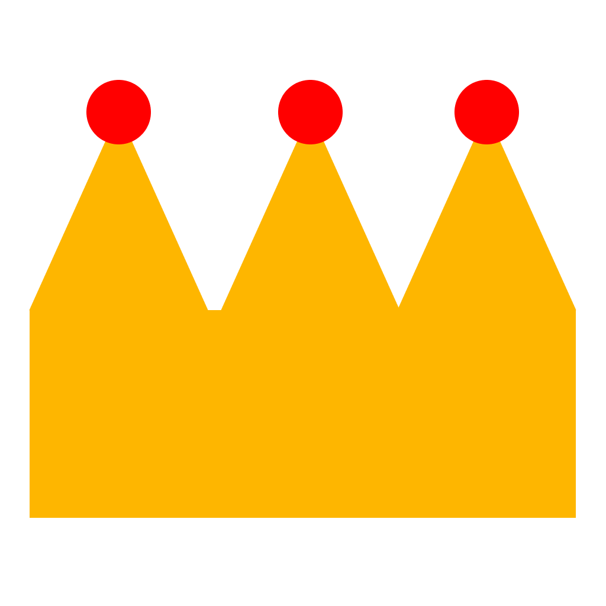

<p align="center"></p>

# Empire Engine

Empire Engine is a 3D game engine written in C# on .NET 10. It draws with Vulkan, and its editor lets you place objects, write
scripts in C# or snap them together from blocks, press Play to try the game, and build it into a program you can hand to
other people.

> **Status: early (0.1.0).** It works and is used to make small games, but expect rough edges and changes between versions.

## What's in it

- **Renderer**: Vulkan, with physically based materials and textures, directional, point and spot lights, sun shadows,
  skies, see-through surfaces and MSAA
- **Editor**: Hierarchy, Inspector, asset browser, move and scale handles, undo, a built-in C# code editor with live error
  checking, and a block-based visual scripting editor
- **Scripting**: C# classes in your project, compiled with Roslyn. Public fields show up in the Inspector, with coroutines,
  collision events and a Unity-style API
- **Systems**: rigidbody physics and raycasts, 3D audio, skeletal animation from glTF, sculptable and paintable terrain,
  particle systems, game UI (buttons, text fields and more, with `OnClick`-style events), scene loading and save games
- **Packages**: optional add-ons made of ordinary scripts. A Water package is included
- **Models**: glTF, FBX and OBJ
- **Builds**: **File > Build Project** makes a standalone game for the computer you're on

## Documentation

Everything is in [`docs/`](docs/index.html), a plain HTML site with no build step: open `docs/index.html` in a browser.
It covers getting started, the editor, scripting, every system, every component's settings, the scripting API, the file
formats and the engine's architecture.

## Getting started

You need the [.NET 10 SDK](https://dotnet.microsoft.com/download) and a graphics card with Vulkan support. On macOS
nothing else is needed (Vulkan is bundled); on Windows and Linux an up-to-date graphics driver provides it.

```sh
git clone https://github.com/ardenarrison/EmpireEngine.git
cd EmpireEngine

dotnet run --project Hub                                                  # the launcher: create and open projects
dotnet run --project Editor -- "/path/to/My Game/Scenes/Main.empirescene" # or open a project's scene directly
dotnet run --project Tests                                                # the test suite
```

In the Hub, **New project** makes a starter project: a scene with a sun, sky, camera and a flat terrain. To package Empire Engine itself
for release, run `python3 publish.py` (see the script's header).

Empire Engine is developed mainly on macOS and works on Windows. Linux builds are supported by `publish.py` but have had the
least testing.

## Making games with Empire Engine

Games you make are yours. Empire Engine claims nothing in them and Apache-2.0 puts no conditions on what you do with them,
free or paid. One condition comes from a library Empire Engine is built on:

- **Every game built with Empire Engine opens with a splash screen** showing the Empire Engine and BRUTAL logos. The
  [BRUTAL License](Licenses/BRUTAL-LICENSE.txt) requires the BRUTAL logo in every product built with BRUTAL, so the splash
  can't be turned off or skipped, and the `NOTICE.txt` and `Licenses/` folder that Build Project puts next to a game must
  ship with it.

## Contributing

Contributions are welcome. Please read [CONTRIBUTING.md](CONTRIBUTING.md) first; it covers how to build, test and send a
change, and the sign-off every commit needs. By taking part you agree to the [Code of Conduct](CODE_OF_CONDUCT.md).
Security problems go through [SECURITY.md](SECURITY.md), not public issues.

## License

Empire Engine's code is licensed under the [Apache License 2.0](LICENSE). The Empire Engine name and crown logo are trademarks and are
not covered by it; see [TRADEMARKS.md](TRADEMARKS.md). Third-party software, and what each part needs from you, is listed
in [NOTICE](NOTICE) and the [`Licenses/`](Licenses) folder. Empire Engine is built on
[BRUTAL](https://www.ahwoo.com/brutal) by Ahwoo Limited.
